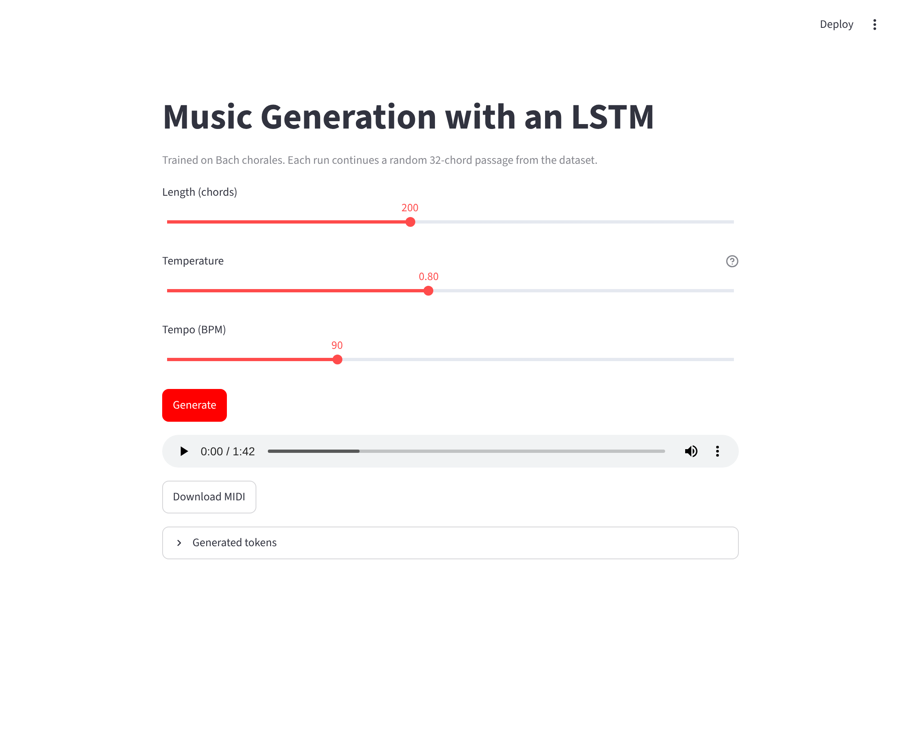
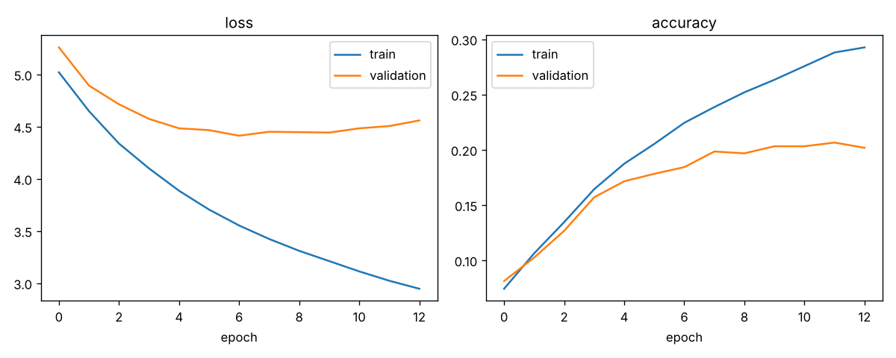

# Music Generation with an LSTM

CodeAlpha AI Internship, Task 3.

An LSTM network trained on 430 Bach chorales that generates new chord progressions and saves them as MIDI and WAV.



Listen to an example: [samples/sample.wav](samples/sample.wav) ([MIDI](samples/sample.mid))

## How it works

1. **Data** (`prepare_data.py`): the Bach chorales that come with music21 are exported to `data/midi/` as MIDI files. Each file is parsed with music21, transposed to C major / A minor, and its parts are merged into chords. Every chord becomes a token like `A.C.E_1.0` (pitch classes + duration in beats). This gives 43k tokens with a vocabulary of 913.
2. **Model** (`train.py`): an Embedding layer, two LSTM layers (256 units) with dropout, and a softmax over the vocabulary. It sees 32 chords and predicts the next one. Training stops early when validation loss stops improving.
3. **Generation** (`generate.py`): start from a random 32-chord passage, predict the next chord, sample it with a temperature, append it and repeat. The tokens are converted back to a MIDI file with music21 and rendered to WAV with pretty_midi.



The best validation accuracy is around 20%. That's expected, since many chords are valid continuations at any point, and the model overfits after about 7 epochs on this small dataset.

## Running it

```
pip install -r requirements.txt

python prepare_data.py   # build data/notes.json (already included)
python train.py          # train the model (a trained one is already in models/)
python generate.py       # write a new piece to output/
streamlit run app.py     # web demo
```

`generate.py` options: `--length 200 --temperature 0.8 --bpm 90`. Lower temperature is safer, higher is more adventurous.

Training takes about 10 minutes on a CPU. To train on your own music, put `.mid` files in `data/midi/` (delete the Bach ones first) and rerun `prepare_data.py` and `train.py`.

## Files

- `music_utils.py`: MIDI to tokens and back, WAV rendering
- `prepare_data.py`: builds the dataset
- `train.py`: model and training
- `generate.py`: sampling and output
- `app.py`: Streamlit demo

Built with Python, music21, TensorFlow/Keras, pretty_midi and Streamlit.
